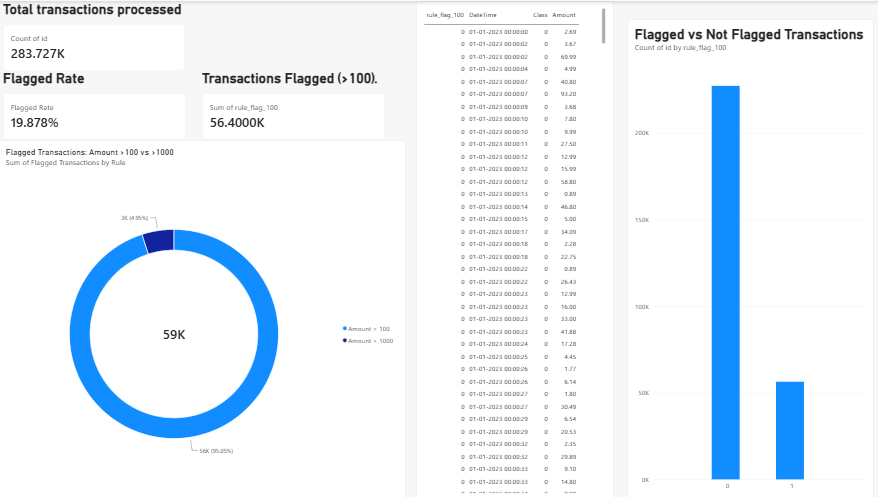

# Fraud Detection & Streaming Analytics

A data analytics portfolio project that uses **Python, MySQL, and Power BI** to explore credit-card transactions, apply simple amount-based fraud flags, simulate batch processing, and summarize results in a dashboard.

> **Important:** This project uses threshold-based rules and a simulated batch workflow. A flagged transaction is an alert for review, not proof of fraud. The notebook processes stored data in batches; it does not consume a live payment stream.

## Dashboard Preview

The Power BI dashboard presents transaction patterns, rule-based fraud detection results, and simulated batch-processing metrics.

### 1. Fraud Detection Overview


### 2. Fraud Rule Analysis


### 3. Transaction & Time Analysis


### 4. Streaming Analytics



## Project Objectives

- Inspect and clean transaction data in Python.
- Remove exact duplicate rows from the working dataset.
- Apply two baseline rules: transaction amount greater than 100 and greater than 1,000.
- Evaluate each rule against the dataset's `Class` label using true positives, false positives, false negatives, true negatives, precision, and recall.
- Simulate batch-by-batch processing to demonstrate monitoring metrics.
- Store processed results in MySQL for analysis in Power BI.
- Validate key counts across Python, MySQL, and Power BI.

## Tools and Technologies

- **Python** — data cleaning, rule flags, batch simulation, validation
- **Pandas** — data manipulation and analysis
- **MySQL** — source and processed-results storage
- **SQLAlchemy / MySQL Connector** — Python-to-MySQL connection
- **Power BI** — dashboarding and KPI reporting
- **Jupyter Notebook** — combined, documented workflow

## Project Structure

```text
Fraud-Detection-Streaming-Analytics/
├── dataset/                         # Local dataset files (if permitted)
├── sql/                             # SQL schema, analysis, and validation queries
├── dashboard/
│   ├── Fraud_Detection_Dashboard.pbix
│   ├── screenshots/
│   ├── dashboard_guide.md
│   └── data_dictionary.md
├── docs/                            # Methodology and limitations
├── reports/                         # Validation report and project findings
├── DOS/                             # Additional project folder, if needed
├── Fraud_Detection_Streaming_Analytics.ipynb
├── README.md
├── requirements.txt
└── .gitignore
```

Adjust the folder names above to match the files actually present in your repository. Do not commit duplicate copies of the same dataset unnecessarily.

## Data

The project is based on a credit-card fraud dataset with anonymized input features:

- `Time` — elapsed time value in the source dataset; it is not an actual calendar timestamp.
- `V1`–`V28` — anonymized numerical features.
- `Amount` — transaction amount.
- `Class` — known label (`0` = legitimate, `1` = fraud).

The working dataset previously contained **284,807 rows**. After removing **1,081 exact duplicate rows**, the expected cleaned dataset size is **283,726 rows**, with **283,253 legitimate transactions** and **473 fraud transactions**. Re-run the notebook and database checks before treating these figures as the current final results, especially if test rows were added to MySQL.

If a synthetic date/time column is used in a dashboard, it must be described as simulated and based on an assumed start date. It is not a real transaction timestamp.

## Fraud-Flagging Rules

| Rule | Meaning |
|---|---|
| `rule_flag_100` | `1` when `Amount > 100`; otherwise `0` |
| `rule_flag` | `1` when `Amount > 1000`; otherwise `0` |

These are simple baseline rules, not a production fraud-detection model. They may flag legitimate high-value transactions and miss fraudulent low-value transactions.

## Previously Observed Results

The following are the project's earlier results on the cleaned dataset. **Verify them against the current notebook and MySQL table before publishing.**

| Metric | Amount > 100 | Amount > 1000 |
|---|---:|---:|
| Transactions flagged | 56,399 | 2,935 |
| True positives (fraud flagged) | 125 | 9 |
| False positives (legitimate flagged) | 56,274 | 2,926 |
| False negatives (fraud not flagged) | 348 | 464 |
| Precision | 0.22% | 0.31% |
| Recall | 26.43% | 1.90% |

The results illustrate a trade-off: the lower threshold catches more fraud cases in this dataset but produces many more false alarms. Precision and recall are calculated using the known `Class` labels.

## Workflow

1. Connect Python to the MySQL database.
2. Read the source `creditcard` table.
3. Inspect missing values, duplicate rows, columns, and class distribution.
4. Remove exact duplicate rows in the working DataFrame.
5. Create amount-based flags.
6. Calculate rule metrics and confusion-matrix counts.
7. Process the working data in batches to simulate streaming.
8. Run validation checks.
9. Write the processed data to `fraud_detection_results` when intentionally required.
10. Refresh the Power BI report and reconcile dashboard KPIs with SQL results.

### MySQL destination warning

The notebook's optional `to_sql(..., if_exists="replace")` operation replaces the destination table. Close Power BI and Excel before replacing a table, and only run that cell when replacement is intended. Never commit database passwords or connection strings containing credentials.

## Validation Checklist

- [ ] Raw row count and duplicate count recorded.
- [ ] Cleaned row count and class counts checked.
- [ ] Both rule totals match the notebook outputs.
- [ ] True positives, false positives, false negatives, and true negatives verified.
- [ ] Batch processed count equals the working DataFrame row count.
- [ ] Batch flagged count equals the selected rule's flag total.
- [ ] MySQL destination row count and rule totals checked with SQL.
- [ ] Power BI KPIs reconciled with MySQL.
- [ ] Simulated dates and simulated streaming are clearly disclosed.
- [ ] No passwords, private connection strings, or restricted data are committed.

## Limitations

- The rules use transaction amount only and do not model broader transaction behavior.
- The dataset is highly imbalanced, so accuracy alone would be misleading.
- A high false-positive count means many flagged transactions may be legitimate.
- The batch loop is a simulation over existing rows, not a real-time streaming system.
- The source `Time` field is elapsed time, not a genuine calendar date/time.
- Power BI in Import mode must be refreshed to load database changes.
- The dataset's license and sharing conditions should be checked before including the raw file in a public repository.

## How to Run

1. Install the dependencies in your Python environment:

   ```bash
   pip install pandas sqlalchemy mysql-connector-python jupyter
   ```

2. Ensure MySQL Server is running and the project database and source table are available.
3. Configure connection values using environment variables such as `MYSQL_HOST`, `MYSQL_USER`, `MYSQL_PASSWORD`, and `MYSQL_DATABASE`. Do not store your password in the notebook.
4. Open `Fraud_Detection_Streaming_Analytics.ipynb` in Jupyter Notebook or VS Code.
5. Run the notebook from top to bottom, checking outputs and validation results.
6. If you choose to write to `fraud_detection_results`, review the destination-write cell first.
7. Open the Power BI `.pbix` report and refresh it to load the latest data.

## Future Improvements

- Add more meaningful features and stronger baseline rules.
- Compare rules with a suitable machine-learning model and evaluate it with imbalance-aware metrics.
- Add time-window and transaction-pattern analysis using valid timestamps where available.
- Introduce a genuine streaming source before describing the project as real-time.
- Automate validation and generate a reproducible report.

## Author

**Sibi Manikandan**  
Data analytics portfolio project
